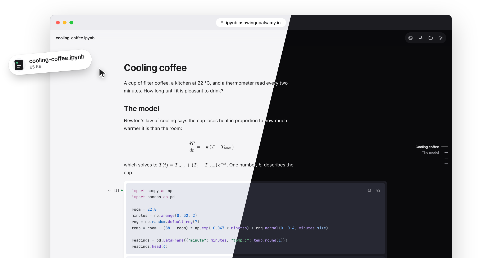

<p align="center">
  <picture>
    <source media="(prefers-color-scheme: dark)" srcset=".github/assets/wordmark-dark.svg">
    
  </picture>
</p>

<p align="center"><b>Jupyter notebooks, without Jupyter.</b><br>Lightweight and fully local. Just drop the file and read it, delightfully.</p>

<p align="center">
  <picture>
    <source media="(prefers-color-scheme: dark)" srcset=".github/assets/tag-never-runs-code-dark.svg">
    
  </picture>
  <a href="LICENSE"><picture>
    <source media="(prefers-color-scheme: dark)" srcset=".github/assets/tag-mit-dark.svg">
    
  </picture></a>
</p>

<p align="center">
  <picture>
    <source media="(prefers-color-scheme: dark)" srcset=".github/assets/hero-dark.png">
    
  </picture>
</p>

## Read a notebook

Open the [viewer](https://ipynb.ashwingopalsamy.in/viewer/) and drop a `.ipynb` anywhere on the page. The [home page](https://ipynb.ashwingopalsamy.in) explains what it does and shows the numbers behind it.

The file never leaves your browser. There is no server to send it to, and no code in it ever runs. After the first visit the app works with the network off, and once a notebook is open the page closes its own connections. If you only want to see what a notebook says, you no longer need a kernel for it.

## What it does

### Reading

- **Reads like a document.** Prose is set in Inter and code in JetBrains Mono, with math typeset and every code cell highlighted, in light or dark.
- **Knows where you are.** A slim rail on the right tracks the chapter you are in and opens into the full outline. When you come back to a notebook, it offers to pick up where you stopped.
- **Fits the page to you.** Text size and page width are yours to set, and so is whether code and outputs show by default.
- **Opens what other tools break.** Notebooks with `NaN` or trailing commas still load, and a file cut off halfway shows every complete cell with a note about the rest. nbformat 3 and 4 both work.

### Outputs

- **Keeps outputs calm.** A progress bar shows only its final state, and a long traceback leads with the line that matters.
- **Turns printed frames into tables.** A `print(df)` block becomes a real table, with numeric columns aligned.
- **Folds the long ones.** A long cell gets a fold handle, and a folded output says in one line what it holds.
- **Shows the order things ran.** Replay puts code cells in execution order, with the prose staying where the author wrote it.

<!-- visual 1: raw traceback and a progress bar, beside the calm version (light/dark pair) -->
<!-- visual 2: a print(df) block, before and after -->

### Sharing

- **Puts figures first.** One tap lays every plot out on a shelf, and each one saves as an image.
- **Shares a cell as a picture.** Press `s` and a cell, code and output, becomes a clean image, ready for a post or a doc. It is drawn in your browser; nothing is uploaded.
- **Copies as text.** Take a cell's code or output as plain text.
- **Checks before you share.** One sheet finds keys and tokens in a notebook, lists what it needs to run, shows what makes it heavy and makes a link with the notebook inside it.

<!-- visual 3: a cell in the viewer, beside the image it exports -->

### Staying current

- **Keeps up with your work.** In Chromium browsers, a notebook you dropped refreshes when it changes on disk, so a notebook saved in Jupyter or written by an agent updates in place.
- **Compares versions.** Put two notebooks side by side, cell by cell, outputs included.

Every shortcut is in [docs/shortcuts.md](docs/shortcuts.md), or press `?` in the app. To try it on something real, drop [examples/cooling-coffee.ipynb](examples/cooling-coffee.ipynb).

## Run it yourself

```sh
git clone https://github.com/ashwingopalsamy/ipynb-viewer
cd ipynb-viewer
npm install
npm run dev
```

It needs Node 22 or newer. `npm run build` writes a static site to `dist/` that any file host can serve.

## How it stays small

The core of the reader is under 30 KB gzipped. Everything else, from code highlighting to math, loads only when a notebook asks for it. [docs/architecture.md](docs/architecture.md) has the rest.

<sub>[MIT](LICENSE) · [Contributing](CONTRIBUTING.md) · [Security](SECURITY.md) · [Changelog](CHANGELOG.md) · Not affiliated with Project Jupyter.</sub>
