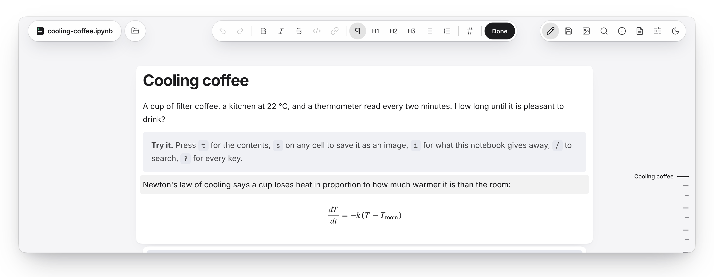

<p align="center">
  <picture>
    <source media="(prefers-color-scheme: dark)" srcset=".github/assets/wordmark-dark.svg">
    
  </picture>
</p>

<p align="center"><b>Jupyter notebooks, without Jupyter.</b><br>Lightweight and fully local. Just drop the file and read it, delightfully.</p>

<p align="center">
  <picture>
    <source media="(prefers-color-scheme: dark)" srcset=".github/assets/tag-never-runs-code-dark.svg">
    
  </picture>
  <a href="LICENSE"><picture>
    <source media="(prefers-color-scheme: dark)" srcset=".github/assets/tag-mit-dark.svg">
    
  </picture></a>
</p>

<p align="center">
  <picture>
    <source media="(prefers-color-scheme: dark)" srcset=".github/assets/hero-dark.png">
    
  </picture>
</p>

## Read a notebook

Open [ipynb.ashwingopalsamy.in](https://ipynb.ashwingopalsamy.in/) and drop a `.ipynb` notebook or a Markdown `.md` file anywhere on the page. No notebook to hand? **Demo**, at the top right of the home page, loads one that is also a tour of the app: a note beside each feature says what to press, and the last sections list everything else. To see an [example notebook](https://ipynb.ashwingopalsamy.in/?url=https%3A%2F%2Fgithub.com%2Fashwingopalsamy%2Fipynb-viewer%2Fblob%2Fmain%2Fexamples%2Fcooling-coffee.ipynb) open from a GitHub link, follow that link.

The file never leaves your browser. There is no server to send it to, and no code in it ever runs. A notebook opened from a link is the one exception on the hosted copy: the site's Worker fetches public GitHub files and gists for the page, which keeps its policy at `connect-src 'self'`, and keeps no record of them. After the first visit the app works with the network off, and once a notebook is open the page closes its own connections. If you only want to see what a notebook says, you no longer need a kernel for it.

## Read several notebooks

Open a second notebook and the first stays where it is. Choose it from the `+` beside the file name or with `⌘O`, drop one or more files on the page, or paste a link into the Open card, and each one opens in a tab of its own. The tabs sit in the header where the file name was, and when they no longer fit, they scroll and a count button lists them all. `{` and `}` step between tabs, `W` closes the one you are reading, and opening the same file or link again brings its tab forward instead of a second copy.

Reload the page and the tabs you opened from a link come back. The ones you opened from files do not, because the page cannot read a file again without you.

Each tab is a page of its own, so the privacy promise holds for each one separately: its own network lock, its own answer about web pictures and its own Privacy count. Allowing pictures in one never allows them in the next. Nothing about a notebook is stored. All that is kept is the web address of each link tab, in the browser tab's own session, and it goes when that session ends.

## Edit a notebook

<p align="center">
  <picture>
    <source media="(prefers-color-scheme: dark)" srcset=".github/assets/edit-dark.png">
    
  </picture>
</p>

Double-click any paragraph, heading or list and write. A bar opens at the top with undo and redo, bold, italic, code, links, headings and lists, and `Esc` or **Done** finishes. Once you are editing, one click on any other text moves the editor there, in this cell or the next, and `↑` `↓` carry on across cells, so there is no double-clicking again. The pencil in the header and the `e` key start it too.

Code and outputs are never touched, and nothing runs. Saving changes only the text of the cells you edited, so figures, tables and outputs stay exactly as they were.

- **Save it into the file.** Open a notebook from your disk in a Chromium browser, and **Save** (`⌘S`) writes into that file. **Save a copy** (`⇧⌘S`) asks where to put `name (edited).ipynb`.
- **Open from a link, edit, save it locally.** Open a notebook from a GitHub link, change what you like, and save it to your computer. A notebook from a link has no file to write to, so saving makes a copy. To try it, [open the example from a link](https://ipynb.ashwingopalsamy.in/?url=https%3A%2F%2Fgithub.com%2Fashwingopalsamy%2Fipynb-viewer%2Fblob%2Fmain%2Fexamples%2Fcooling-coffee.ipynb), edit a sentence and press `⌘S`. Browsers that cannot write files download the copy instead.
- **Markdown too.** A `.md` file opens and edits the same way.

Nothing is uploaded: edits stay in the page until you save, and saving writes to your own disk. If the file changed on disk while you were editing, your edits go to a new file and the original is left alone.

## What it does

### Reading

- **Reads Markdown too.** A `.md` file opens as a notebook of one text cell, with math, tables and code drawn the same way, and edits and saves like any notebook.
- **Reads like a document.** Prose is set in Inter and code in JetBrains Mono, with math typeset and every code cell highlighted, in light or dark.
- **Holds several at once.** Notebooks open as tabs in the header, side by side, each with its own privacy settings.
- **Knows where you are.** A slim rail on the right tracks the chapter you are in and opens into the full outline. When you come back to a notebook, it offers to pick up where you stopped.
- **Fits the page to you.** Text size, page width, a book face for text, line numbers and wrapping are in Settings, and `c` and `o` hide the code or the outputs of the whole page.
- **Opens what other tools break.** Notebooks with `NaN` or trailing commas still load, and a file cut off halfway shows every complete cell with a note about the rest. nbformat 3 and 4 both work.

### Outputs

- **Keeps outputs calm.** A progress bar shows only its final state, and a long traceback leads with the line that matters.
- **Turns printed frames into tables.** A `print(df)` block becomes a real table, with numeric columns aligned.
- **Folds the long ones.** A long cell gets a fold handle, and a folded output says in one line what it holds.
- **Shows the order things ran.** Replay puts code cells in execution order, with the prose staying where the author wrote it.

<!-- visual 1: raw traceback and a progress bar, beside the calm version (light/dark pair) -->
<!-- visual 2: a print(df) block, before and after -->

### Sharing

- **Puts figures first.** One tap lays every plot out on a shelf, and each one saves as an image.
- **Shares a cell as a picture.** Press `s` and a cell, code and output, becomes a clean image, ready for a post or a doc. It is drawn in your browser; nothing is uploaded.
- **Copies as text.** Take a cell's code or output as plain text.
- **Checks before you share.** One sheet finds keys and tokens in a notebook, lists what it needs to run, shows what makes it heavy and makes a link with the notebook inside it.

<!-- visual 3: a cell in the viewer, beside the image it exports -->

### Editing

- **Edits where you read.** The page does not change into an editor: the text stays set as it was, with a card behind it and a bar above.
- **Takes anything back.** `⌘Z` and `⇧⌘Z` undo and redo edits, and the unsaved dot in the header and the tab title follow them.
- **Checks before it writes.** A cell that changed underneath you is not overwritten, and closing a tab, closing the page or reloading warns while edits are unsaved.

### Staying current

- **Keeps up with your work.** In Chromium browsers, a notebook you dropped refreshes when it changes on disk, so a notebook saved in Jupyter or written by an agent updates in place.
- **Compares versions.** The notebook sheet lists every cell added, removed or edited since an earlier file, and every output that changed.

Every shortcut is in [docs/shortcuts.md](docs/shortcuts.md), or press `?` in the app. To try it on something real, drop [examples/cooling-coffee.ipynb](examples/cooling-coffee.ipynb).

## Run it yourself

```sh
git clone https://github.com/ashwingopalsamy/ipynb-viewer
cd ipynb-viewer
npm install
npm run dev
```

It needs Node 22 or newer. `npm run build` writes a static site to `dist/` that any file host can serve.

## How it stays small

The core of the reader is under 30 KB gzipped. Everything else, from code highlighting to math, loads only when a notebook asks for it. [docs/architecture.md](docs/architecture.md) has the rest.

<sub>[MIT](LICENSE) · [Contributing](CONTRIBUTING.md) · [Security](SECURITY.md) · [Changelog](CHANGELOG.md) · Not affiliated with Project Jupyter.</sub>
